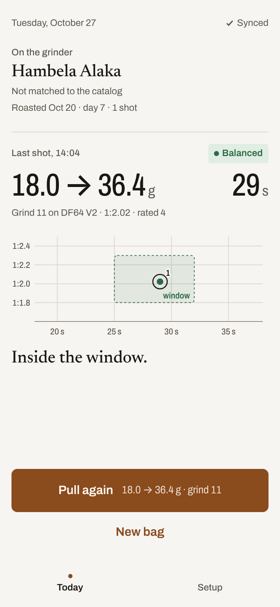
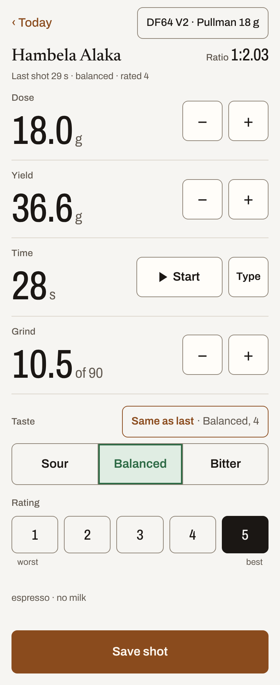
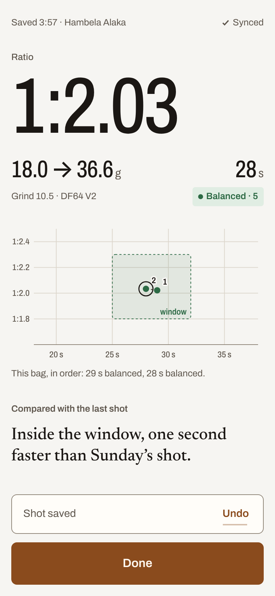
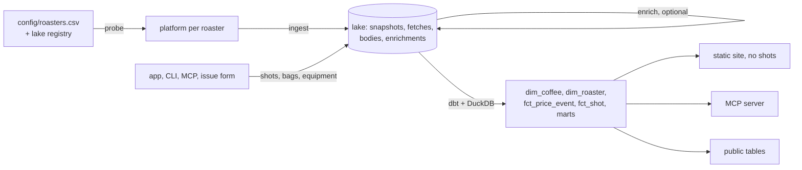

# coffee-data-tracker

[](https://github.com/jtouley/coffee-data-tracker/actions/workflows/ci.yml)
[](LICENSE)

A weekly catalog of what US specialty roasters sell online, and a phone app that links each espresso shot to a
coffee in it.

Every roaster runs its own online store, so there's no single place to compare origins, processes and prices, or to
see when a coffee's price changes or it sells out. A paper shot log isn't tied to a specific coffee or grinder. This
project reads each roaster's public store once a week, starting from a seed list of about 3,200 US roasters, keeps
every weekly snapshot, and turns them into tables you can query with SQL: what's listed now, what changed, and how
your shots of a given coffee went. The weekly job runs on a GitHub Actions schedule and needs no server. The data lives in a lake
of Parquet files: a Hugging Face dataset or a local folder.

**Write-ups on Medium:** [From Bean to Byte: Embarking on a Data-Driven Coffee Journey](https://medium.com/@jtouley/from-bean-to-byte-embarking-on-a-data-driven-coffee-journey-8a73e6b70c7f)
· [Dialing In: The Technical Brew Behind My Coffee Data Journey](https://medium.com/@jtouley/dialing-in-the-technical-brew-behind-my-coffee-data-journey-b0d579bc5b1d)

<!-- More links: each one stays commented out until it works. -->
<!-- Uncomment once the Pages site is live: **Catalog site:** [jtouley.github.io/coffee-data-tracker](https://jtouley.github.io/coffee-data-tracker/) -->
<!-- Uncomment once the public dataset is published: **Public dataset:** [Hugging Face](https://huggingface.co/datasets/jtouley/<name>) -->
<!-- Uncomment once the listing is approved: **Snowflake Marketplace:** [<listing name>](<listing URL>) -->
<!-- Uncomment once the Space is live: **App:** [Hugging Face Space](https://huggingface.co/spaces/jtouley/<name>) -->
<!-- Uncomment once the post is up: **Substack:** [<post title>](<Substack URL>) -->

<p>
  
  
  
</p>

**Status:** personal project, version 0.1.0, US roasters only.

**Contents:** [Quick start](#quick-start) · [Usage](#usage) · [Configuration](#configuration) ·
[Run it on GitHub](#run-it-on-github) · [How it works](#how-it-works) · [Limitations](#limitations) ·
[Development](#development)

- **Reads the stores directly.** Adapters for Shopify, WooCommerce, Squarespace and Square Online, with a fallback
  that reads schema.org product markup from a site's sitemap, so a roaster on a known platform needs no new code.
- **Keeps full history.** Price changes, new arrivals, delistings and relistings are worked out from the weekly
  records.
- **Extracts coffee attributes.** Origin, process, varietals, elevation, roast level and tasting notes come from tags and
  text rules. With an Anthropic API key, Claude Haiku fills in what the rules miss.
- **Links each shot to a coffee and grinder.** Log shots from the phone app, the CLI, Claude (MCP) or a GitHub
  issue. Each one is matched to a catalog coffee and can name the grinder it was ground on.
- **Publishes a static site and facts-only [public tables](#public-tables).** Your shots appear in neither.

## Quick start

You need [uv](https://docs.astral.sh/uv/) (it installs Python 3.12 if you don't have it), `git` and network access:
the run fetches live roaster sites. Run every command from the repo root, because `config/`, `dbt/` and `docs/` are
read through relative paths. CI runs on Ubuntu.

> [!NOTE]
> On days 1–7 of a month, `weekly` first runs roaster discovery against Overture Maps and OpenStreetMap, and
> `SAMPLE` doesn't limit that step. Leave out `SAMPLE` to fetch every roaster; the GitHub workflow allows 4 hours.

```bash
git clone https://github.com/jtouley/coffee-data-tracker.git
cd coffee-data-tracker
make install                 # uv sync
make weekly SAMPLE=50        # 50 roasters into ./lake, then the dbt build and the site
make app                     # the shot-logging app on http://127.0.0.1:8000
```

Among the other progress output, `make weekly` prints a line like this:

```text
built build/coffee.duckdb; exported dim_coffee, dim_roaster, mart_market, fct_price_event, fct_shot to lake/marts
```

You then have `lake/` (the raw Parquet records, ignored by git), `build/coffee.duckdb` (the dbt models),
`build/site/index.html` (with `catalog.json` next to it) and `build/public/` (the public tables). Open
`build/site/index.html` in a browser (`open` on macOS, `xdg-open` on Linux).

## Usage

### Log shots in the app

<!-- Once docs/app/RUNNING.md lands (app-m2), link it here for real sign-in, the Hugging Face Space and its secrets, and keep this section short. -->

`app/` is a small FastAPI app with server-rendered pages, made for a phone at the espresso machine. It reads and
writes the same lake as everything else (`COFFEEDATA_LAKE`, `./lake` by default). `make install` already installs
what it needs; `uv sync --no-dev --extra app` installs it without the dev tools.

```bash
make app                     # http://127.0.0.1:8000, reloads when the code changes
HOST=0.0.0.0 make app        # reachable from a phone on the same network
PORT=8080 make app
```

- **Setup:** your grinder (its dial range and step, and whether lower numbers are finer) and your basket (its
  nominal dose). Do this first.
- **New bag:** type the roaster and coffee as on the bag, plus the roast date. It's matched to the catalog when the
  match is clear, which needs a built catalog (`make weekly` or `make build`).
- **Log shot:** starts from the last shot of the bag. Time, taste and rating start empty, with a "Same as last"
  button and a shot timer.
- **Saved:** shows the ratio and where the shot landed against the 25–32 s, 1:2 window, next to the bag's earlier
  shots, and says how it compares with the last one. For 5 seconds it offers **Undo**, which writes a retraction
  record; nothing is deleted.

Each save waits in the phone's IndexedDB until the server acknowledges it, so a save made offline goes through
later, and a retry never creates a second shot. The app shows where each shot landed but gives no grind advice; that
waits until a model trained on logged shots does better than the rule the other tools use (below).

> [!WARNING]
> The app has no access control: every request is treated as the owner (`COFFEEDATA_OWNER_ID`, default `owner`).
> With `HOST=0.0.0.0`, anyone on your network can log shots. The app refuses to start on a Hugging Face Space.

The app reads the lake only when it starts. To see shots logged from the CLI, Claude (MCP) or an issue, restart the
app.

### Log shots elsewhere

Every way of logging a shot writes it to the lake and matches it to a catalog coffee. The CLI, Claude (MCP) and the
issue form also reply with advice for the next shot, aiming for about 1:2 in 25–32 s: a sour shot means grind finer
and a bitter one coarser; with no taste given, a fast shot means finer and a slow one coarser. Which way is finer
comes from the Setup of the last shot's grinder, or lower numbers if none is set.

**From the command line:**

```bash
uv run coffeedata shot add --json '{"coffee": "Onyx Geometry", "in": 18, "out": 38, "time": 29, "grind": 15, "rating": 3, "taste": "sour"}'
```

```text
Logged shot `<shot id>`.

Last shot: 18 g → 38 g (1:2.1) in 29 s at grind 15. It tasted sour: go finer to 14 to slow the shot and extract more.
```

Once the catalog is built, the reply also names the matched coffee, or the closest candidates if the match isn't
certain. Add `"grinder_name": "DF64 V2"` to tie the shot to a grinder from the app's Setup. The key `"grinder"`
is an alias for `grind`, the grind setting.

To correct a shot, run `shot add` again with its `shot_id` and every field (include `brewed_at`, or it becomes the
current time); the latest record wins. Add `"deleted": true` to such a full record to retract it.

**From Claude**, register the MCP server once (for a local lake, leave out both `-e` flags):

```bash
claude mcp add coffee-data -e COFFEEDATA_LAKE=hf://datasets/<you>/coffee-data -e HF_TOKEN=<token> \
  -- uv run --directory /path/to/coffee-data-tracker coffeedata mcp
```

Then say something like "log a shot: Onyx Geometry, 18 in, 38 out, 29 s, grind 15 on the DF64 V2, a bit sour,
3/5". The server has `log_shot` (with an optional `grinder_name`), `search_coffees`, `shot_history`,
`suggest_next` and `run_sql` (one read-only `SELECT` against the models in `build/coffee.duckdb`).

**From GitHub**, open an issue with the "Log a shot" form; its optional Grinder field takes a grinder name. The
`issue-forms` workflow records the shot, replies with the match and advice, and closes the issue. It only acts on
issues the repo owner opens.

A grinder name is looked up among the grinders in the same lake, so run the app against the lake the workflow and
the MCP server use. An unknown name fails with the list of known grinders.

| | App | CLI | Claude (MCP) | Issue form |
|---|---|---|---|---|
| Advice for the next shot | no | yes | yes | yes |
| Correct a shot | no | log the full record again with its `shot_id` | no | no |
| Retract a shot | Undo, for 5 s after saving | the full record plus `"deleted": true` | no | no |

### Query the data

DuckDB comes with the project's dependencies, so you can query the models without installing anything else:

```bash
uv run python -c "import duckdb; duckdb.connect('build/coffee.duckdb', read_only=True).sql(\"\"\"
  select origin_country, count(*) as coffees from dim_coffee
  where is_listed group by 1 order by 2 desc limit 10\"\"\").show()"
```

```sql
-- Cheapest in-stock single-origin Ethiopians per 100 g
select roaster_name, title, price_per_100g, url from dim_coffee
where origin_country = 'Ethiopia' and in_stock and not is_blend order by price_per_100g limit 10;

-- Price changes in the last month
select run_date, coffee_id, previous_price_usd, price_usd from fct_price_event
where event = 'price' and run_date >= current_date - 30 order by run_date desc;

-- What worked last time, per coffee and grinder (needs logged shots)
select label, grinder_name, best_grind, best_dose_g, best_yield_g, best_time_s, avg_rating, shots
from mart_dial_in where grain = 'coffee' order by last_brewed_at desc;

-- Washed vs natural ratings
select process, count(*) shots, round(avg(rating), 2) avg_rating from fct_shot group by 1 order by 3 desc;

-- Straight from a Hugging Face lake
select origin_country, count(*) from 'hf://datasets/<you>/coffee-data/marts/dim_coffee.parquet'
where is_listed group by 1 order by 2 desc;
```

| Model | One row per |
|---|---|
| `dim_coffee` | coffee ever seen, with attributes, sizes, price per 100 g, `in_stock` and `is_listed` |
| `dim_roaster` | roaster, with platform and status |
| `fct_price_event` | change: `new`, `price`, `availability`, `removed` or `relisted` |
| `fct_shot` | current shot, with its bag, grinder (`grind_position` compares across grinders) and catalog coffee |
| `dim_equipment` | grinder, machine or basket, retired ones included |
| `mart_dial_in` | your best recipe per coffee and grinder, and per origin and process |
| `mart_market`, `mart_new_arrivals` | market summary by origin and process; coffees new in each roaster's latest run |

`dim_coffee`, `dim_roaster`, `mart_market`, `fct_price_event` and `fct_shot` are also exported to the lake's
`marts/` each run. `fct_shot` holds your shots, so keep the lake private (`coffeedata init` makes it private unless
you pass `--public`).

### Commands

| `make` target | Runs | What it does |
|---|---|---|
| `make weekly [SAMPLE=N]` | `coffeedata weekly` | The full weekly run (see [How it works](#how-it-works)) |
| `make app` | `uvicorn app.main:app` | The shot-logging app; `HOST` and `PORT` default to `127.0.0.1` and `8000` |
| `make init` | `coffeedata init` | Create the lake. For `hf://`, a private dataset, its card and schemas (`make init PUBLIC=1` for a public one) |
| `make discover` | `coffeedata discover overture`, `discover osm` | Record roasters from open datasets |
| `make probe` | `coffeedata probe` | Detect the store platform for roasters not checked in 28 days |
| `make ingest [SAMPLE=N]` | `coffeedata ingest` | Fetch catalogs for today's run, skipping roasters already fetched |
| `make enrich` | `coffeedata enrich` | Claude enrichment (needs `ANTHROPIC_API_KEY`) |
| `make build` / `make site` | `coffeedata build` / `site` | dbt build and mart export / the static site (runs `build` first) |
| `make publish` | `coffeedata publish` | Upload staged files to a remote lake |
| `make mcp` | `coffeedata mcp` | Run the MCP server over stdio |

The CLI also has `export-public --to <dir|hf://|s3://|gs://>`, `load-snowflake` (`make install` includes the
connector; with `--no-dev`, add `--extra snowflake`), `shot add|from-issue` and `add-roaster`. `uv run coffeedata
<command> --help` lists each command's flags.

## Configuration

Everything is set through environment variables. Nothing is required for a local run.

| Variable | Default | Used for |
|---|---|---|
| `COFFEEDATA_LAKE` | `lake` | Where the lake lives: a local folder, or `hf://datasets/<owner>/<name>` |
| `HF_TOKEN` | none | Reading and writing a Hugging Face lake or public export |
| `COFFEEDATA_STAGING` | `build/lake-staging` | Where new files wait before upload to a remote lake |
| `COFFEEDATA_DB` | `build/coffee.duckdb` | The DuckDB file the MCP server reads. `build`, `weekly`, `site` and `export-public` take `--db` instead (same default) |
| `COFFEEDATA_PHOTOS` | `lake-photos` | A separate private dataset for bag photos. Nothing writes photos yet |
| `COFFEEDATA_OWNER_ID` | `owner` | The owner's `user_id`; shots, bags and equipment with no `user_id` are the owner's |
| `COFFEEDATA_OWNER` | `owner` | The owner's display name in the app |
| `HOST`, `PORT` | `127.0.0.1`, `8000` | Where `make app` listens |
| `ANTHROPIC_API_KEY` or `ANTHROPIC_AUTH_TOKEN` | none | Claude enrichment. Without it, attributes come from the rules only |
| `PUBLIC_EXPORT_URL` | `build/public` | Where `weekly` and `export-public` send the public tables |
| `SNOWFLAKE_ACCOUNT`, `SNOWFLAKE_USER`, `SNOWFLAKE_PRIVATE_KEY` | none | Snowflake load. With `SNOWFLAKE_ACCOUNT` set, `weekly` loads Snowflake too |
| `SNOWFLAKE_ROLE`, `SNOWFLAKE_WAREHOUSE`, `SNOWFLAKE_DATABASE` | `COFFEE_LOADER`, `COFFEE_WH`, `COFFEE_DATA` | Snowflake overrides |
| `AWS_ACCESS_KEY_ID`, `AWS_SECRET_ACCESS_KEY`, `AWS_REGION` | none | `s3://` exports (any DuckDB AWS credential source works) |
| `GCS_HMAC_KEY_ID`, `GCS_HMAC_SECRET` | none | `gs://` exports |

The seed list is [`config/roasters.csv`](config/roasters.csv): 3,205 roasters from Overture Maps and a curated
list. Roasters added later by discovery (including OpenStreetMap) or the issue form are recorded in the lake, and
this file stays as it is.

## Run it on GitHub

The `weekly` workflow runs every Monday, keeps the data in a Hugging Face dataset and deploys the site to Pages.

1. Create a write token at huggingface.co → Settings → Access Tokens.
2. Create the dataset once, from any machine. It's private unless you add `--public`; keep it private, because
   the run exports your shots to its `marts/fct_shot.parquet`.
   ```bash
   COFFEEDATA_LAKE=hf://datasets/<you>/coffee-data HF_TOKEN=<token> uv run coffeedata init
   ```
3. In the repo's Actions settings, add the variable `LAKE_URL` = `hf://datasets/<you>/coffee-data` and the secret
   `HF_TOKEN`. Optionally add the secret `ANTHROPIC_API_KEY`; the variable `PUBLIC_EXPORT_URL` (for `s3://`, also
   the AWS secrets and the `AWS_REGION` variable); and for Snowflake the variables `SNOWFLAKE_ACCOUNT` and
   `SNOWFLAKE_USER` and the secret `SNOWFLAKE_PRIVATE_KEY` (see [`marketplace/README.md`](marketplace/README.md)).
4. Under Settings → Pages, set Source to GitHub Actions.
5. Create the `shot` and `roaster` issue labels. The issue forms rely on them.
6. Run the `weekly` workflow by hand with `sample: 50`. After that it runs on its own every Monday.

No workflow deploys the app. To log shots from the app into the same lake, start `make app` with `COFFEEDATA_LAKE` and
`HF_TOKEN` set. Each save is then uploaded before the app acknowledges it.

## How it works

### The weekly run



`coffeedata weekly` runs these steps in order:

1. Discovery from Overture and OSM, once in the first week of each month (or with `--discover`).
2. Platform checks for roasters not checked in 28 days.
3. Ingest of every roaster with a usable platform, then one retry of that run's failures.
4. Claude enrichment, if a key is set: collect finished batches, then submit pending coffees.
5. The dbt build, and export of the marts.
6. The public tables, plus the Snowflake load if it's configured.
7. The site.

With a remote lake, the run uploads after steps 2 through 5, and every 200 roasters during ingest, so a later
failure or a timeout keeps what was already fetched. Running the same week again picks up where it stopped.

**The lake is append-only, apart from `marts/`.** Each step adds files and never edits or deletes one, and
`Lake.write` refuses to overwrite. The derived `marts/` exports are replaced each run. Everything that describes the
current state is computed:

| Lake path | Written by | Holds |
|---|---|---|
| `snapshots/run_date=…/batch=…` | ingest | every product seen (coffee or not), with variants and prices |
| `fetches/…` | ingest | one row per roaster attempt, `ok` or `error` |
| `bodies/…` | ingest | product description text, stored once per new description |
| `enrichments/method=rules\|llm/…` | ingest, enrich | extracted attributes, keyed by product and description hash |
| `probes/…` | probe | store platform checks |
| `registry/source=…/…` | discover, issue form | roasters added (or opted out) beyond the seed list |
| `llm_batches/state=submitted\|collected/…` | enrich | Claude Message Batches bookkeeping |
| `shots/<id>__<time>-<random>.parquet` | app, CLI, MCP, issue form | one logged shot; corrections and retractions are new files |
| `equipment/<id>__<time>.parquet` | app | a grinder, machine or basket; changes are new files |
| `bags/<id>__<time>.parquet` | app | a bag of coffee in use, matched to the catalog when it can be |
| `marts/*.parquet` | build | derived, and replaced each run |

Bag photos have their own dataset (`COFFEEDATA_PHOTOS`), one `photos/<id>.parquet` per photo in Hugging Face's
`Image` layout, so a photo is never in the main lake. The schema is in place; nothing uploads photos yet.

- **Re-running a week is safe.** Only roasters without a successful fetch that week are fetched again, and
  `stg_runs` keeps only the latest successful batch per roaster and week (checked in `tests/test_dbt.py`).
- **A site being down never looks like a delisting.** A failed fetch is recorded with no products, and price
  events compare consecutive *successful* fetches.
- **Stable coffee IDs.** `coffee_id` is `<roaster domain>:<store product id>`, so a rename doesn't change it.
- **Old shots keep their gear.** Each grinder or basket added in Setup is a new record, so a shot keeps the
  equipment it was pulled with. A grind setting only compares within one grinder; `grind_position` (0 to 1 along
  the dial) is a rough comparison across grinders.
- **Past weeks can be re-processed.** Raw records keep non-coffee products and description text, so a better
  classifier or extractor can run over old weeks without fetching again.
- **Roaster status comes from history:** `active`, `no_coffee`, `no_catalog`, `pending`, `unreachable` or
  `opted_out`. A roaster with a known platform becomes `unreachable` after its last 3 weekly runs all failed, and a
  failed probe never erases a known platform. A roaster with no usable platform (none found yet, or an HTTP error
  such as `http_403`) is `unreachable` straight away.
- **Enrichment cost is capped.** Claude only sees coffees the rules couldn't fully read that have no `llm` result
  and aren't in a pending batch, up to `--limit` (default 2000). Up to 100 go through the API directly; more go
  through the Message Batches API and are collected next run. Anything skipped is picked up the following week.

Hugging Face datasets are versioned, handle Parquet well and can be queried by anyone with DuckDB. Git would be a
poor home for this data: its history only grows and every Actions checkout would download it. Lake storage lives
in `lake.py`, which is where another object store would plug in.

### Public tables

Four facts-only tables (`dbt/models/public/`): `public_coffee` (attributes, sizes, prices, stock and a link back to
the roaster), `public_price_event`, `public_market_weekly` and `public_roaster`. Descriptions and images belong to
the roasters, so they stay in the private lake. The tables leave out opted-out roasters and roasters known only from
OpenStreetMap, whose ODbL share-alike license would otherwise apply to the whole table. The
`public_tables_are_facts_only` dbt test fails the build if a public table has a column on its denylist:
descriptions, images, store IDs, shot fields such as `rating`, `notes` and doses, and user, bag, grinder and photo
IDs. Snowflake and Databricks setup and the listing text are in [`marketplace/`](marketplace/README.md).

### Scraping etiquette

- Each store feed is read once a week, because catalogs change slowly and that keeps the load on small roaster
  sites low. Requests use a User-Agent that names this project and links to this repo.
- `robots.txt` is followed, and a 401 or 403 on it counts as "disallow everything". Catalog requests to a host are
  at least 1 second apart, platform probes at least 0.5 seconds apart.
- Only what a shopper can see is stored, and every coffee links back to its roaster.
- Roasters who want to be left out can open an issue. The owner records the opt-out with the "Exclude this
  roaster" box on the "Add a roaster" form, and the site is never fetched again.
- By design, the project doesn't use directories whose terms forbid scraping, sources whose terms forbid storing
  their data, or sites that block bots.

## Limitations

- **US only, one person.** Discovery filters to US places, and the issue forms only act on the repo owner's
  issues.
- **The app is a first version.** It has no photo upload and no way to edit a shot or a bag; bags are typed by hand.
- **No hosted dataset.** You create and run your own lake; this repo doesn't link to a published copy.
- **Coverage depends on the stores.** Sites that block bots or publish no machine-readable catalog show up as
  `unreachable`, `no_catalog` or `no_coffee` in `dim_roaster`.
- **Attributes are a best guess,** by rules or by Claude. The roaster's own listing is authoritative.
- **Marketplace listings** on Snowflake and Databricks need their own accounts and reviews. See
  [`marketplace/README.md`](marketplace/README.md).

## Development

```bash
make hooks   # once: install the pre-commit hooks
make test    # make lint, then pytest: unit tests, app tests and dbt builds over synthetic multi-week lakes
make fmt     # ruff fix and format over src, app and tests
make clean   # remove build/ and dbt artifacts
```

- The tests run offline, with recorded store responses (`tests/fixtures/`), mocked HTTP (`respx`), synthetic lakes
  and FastAPI's test client.
- One browser test (`tests/test_app_browser.py`) drives Log shot → Saved → Undo at phone width; it needs Node with
  Playwright and is skipped without it.
- `make lint` runs the pre-commit hooks on every file (whitespace, YAML/TOML, large-file and private-key checks,
  `uv.lock` in step with `pyproject.toml`, ruff and mypy over `src` and `app`); the first run downloads the hook
  repos, so it needs network once.
- CI (`.github/workflows/ci.yml`) runs `uv sync --locked` and `make test` on every pull request and push to `main`.

Report bugs and questions on the [issue tracker](https://github.com/jtouley/coffee-data-tracker/issues).

## History

This started in March 2024 as a way to log espresso shots from a Squarespace form into GCP, with a Cloud Function,
BigQuery and Terraform, alongside a separate repo of per-site Selenium and GPT-3.5 scrapers. The rewrite kept the
goal and the shot fields. It reads store JSON feeds, takes roasters from open datasets, keeps a Parquet lake built
with dbt and DuckDB, and logs shots from a phone app, Claude (MCP) and issue forms. The GCP version is commit
[`92f74da`](https://github.com/jtouley/coffee-data-tracker/tree/92f74da332184533e4c10e3dab83c9fb44e0d796).

## License

The code is released under the [MIT License](LICENSE). Roaster data comes from Overture Maps Places
(CDLA-Permissive-2.0) and OpenStreetMap (ODbL, © OpenStreetMap contributors); product names, descriptions and
images belong to the roasters. See [`docs/ATTRIBUTION.md`](docs/ATTRIBUTION.md).
