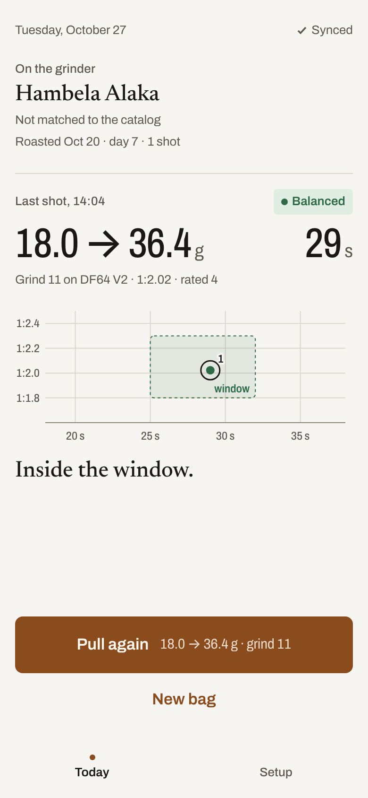
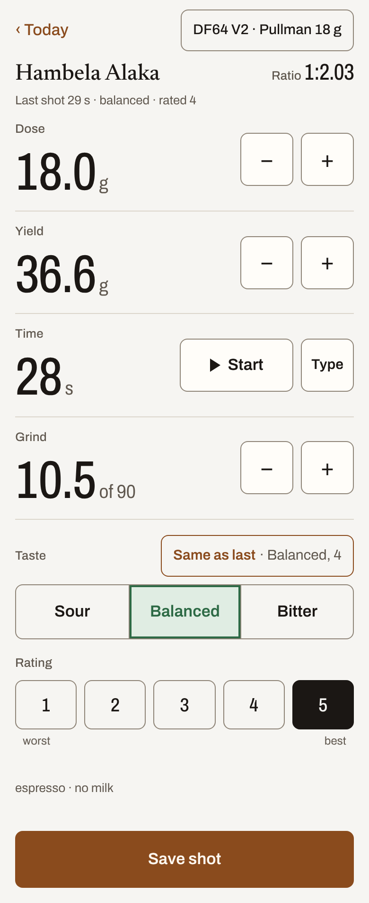
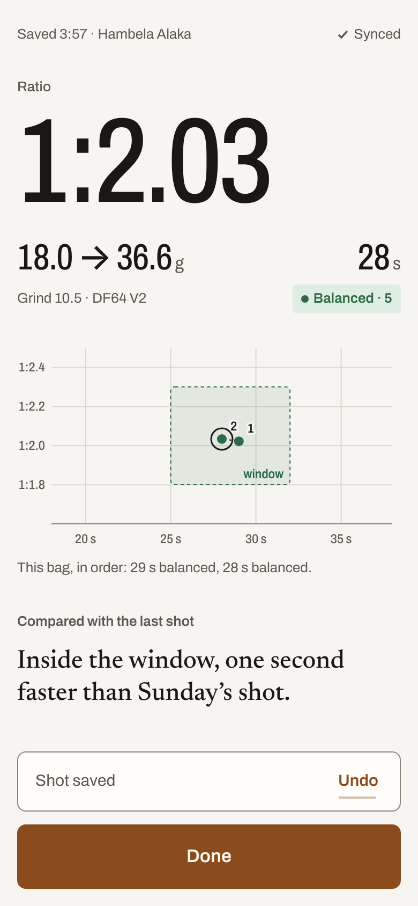
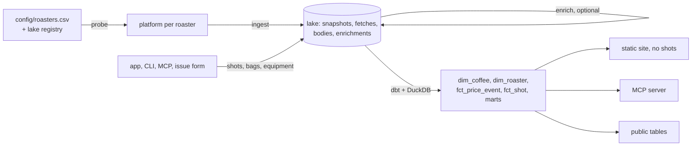

# coffee-data-tracker

[](https://github.com/jtouley/coffee-data-tracker/actions/workflows/ci.yml)
[](LICENSE)
[](licenses/CDLA-Permissive-2.0.txt)

A weekly catalog of what US specialty roasters sell online, and a phone app that links each espresso shot to a
coffee in it.

Every roaster runs its own online store, so there's no single place to compare origins, processes and prices, or to
see when a coffee's price changes or it sells out. A paper shot log isn't tied to a specific coffee or grinder. This
project reads each roaster's public store once a week, starting from a seed list of US roasters, keeps
every weekly snapshot, and turns them into tables you can query with SQL: what's listed now, what changed, and how
your shots of a given coffee went. The weekly crawl runs as scheduled Cloud Run jobs, and GitHub Actions publishes the site. The data lives in a lake
of Parquet files: a Hugging Face dataset or a local folder.

**Catalog site:** [registry.coffee](https://registry.coffee/catalog/)

**Write-ups on Medium:** [From Bean to Byte: Embarking on a Data-Driven Coffee Journey](https://medium.com/@jtouley/from-bean-to-byte-embarking-on-a-data-driven-coffee-journey-8a73e6b70c7f)
· [Dialing In: The Technical Brew Behind My Coffee Data Journey](https://medium.com/@jtouley/dialing-in-the-technical-brew-behind-my-coffee-data-journey-b0d579bc5b1d)

<!-- More links: each one stays commented out until it works. -->
<!-- Uncomment once the public dataset is published: **Public dataset:** [Hugging Face](https://huggingface.co/datasets/jtouley/<name>) -->
<!-- Uncomment once the listing is approved: **Snowflake Marketplace:** [<listing name>](<listing URL>) -->
<!-- Uncomment once the post is up: **Substack:** [<post title>](<Substack URL>) -->

<p>
  
  
  
</p>

**Status:** personal project, version 0.1.0, US roasters only.

**Contents:** [Quick start](#quick-start) · [How it works](#how-it-works) · [Data access](#data-access) ·
[Documentation](#documentation) · [Limitations](#limitations) · [Development](#development)

- **Reads the stores directly.** Adapters for Shopify, WooCommerce, Squarespace and Square Online, with a fallback
  that reads schema.org product markup from a site's sitemap, so a roaster on a known platform needs no new code.
- **Keeps full history.** Price changes, new arrivals, delistings and relistings are worked out from the weekly
  records.
- **Extracts coffee attributes.** Origin, process, varietals, elevation, roast level and tasting notes come from tags and
  text rules. With an Anthropic API key, Claude Haiku fills in what the rules miss.
- **Links each shot to a coffee and grinder.** Log shots from the phone app, the CLI, Claude (MCP) or a GitHub
  issue. Each one is matched to a catalog coffee and can name the grinder it was ground on.
- **Publishes a static site and facts-only [public tables](#public-tables).** Your shots appear in neither.

## Quick start

You need [uv](https://docs.astral.sh/uv/) (it installs Python 3.12 if you don't have it), `git` and network access:
the run fetches live roaster sites. Run every command from the repo root, because `config/`, `dbt/` and `docs/` are
read through relative paths. CI runs on Ubuntu.

> [!NOTE]
> On days 1–7 of a month, `weekly` first runs roaster discovery against Overture Maps and OpenStreetMap, and
> `SAMPLE` doesn't limit that step. Leave out `SAMPLE` to fetch every roaster; the GitHub workflow allows 4 hours.

```bash
git clone https://github.com/jtouley/coffee-data-tracker.git
cd coffee-data-tracker
make install                 # uv sync
make weekly SAMPLE=50        # 50 roasters into ./lake, then the dbt build and the site
make app                     # the shot-logging app on http://127.0.0.1:8000
```

Among the other progress output, `make weekly` prints a line like this:

```text
built build/coffee.duckdb; exported dim_coffee, dim_roaster, mart_market, fct_price_event, fct_shot, mart_bag to lake/marts
```

You then have `lake/` (the raw Parquet records, ignored by git), `build/coffee.duckdb` (the dbt models),
`build/site/` (the static site) and `build/public/` (the public tables). Open `build/site/catalog/index.html` in a
browser.

## How it works



Each Monday, Cloud Run jobs read every roaster's store catalog (re-checking its platform every 28 days) into an
append-only lake of Parquet files. On Tuesday, dbt and DuckDB build the models, release checks decide whether the
build is served, and the `site` workflow publishes the site and the public tables.
[docs/ARCHITECTURE.md](docs/ARCHITECTURE.md) covers each step, the lake's layout, the data-quality gates, the
contracts and the crawler's etiquette.

## Data access

DuckDB comes with the project, so after `make weekly` you can query the models directly:

```bash
uv run python -c "import duckdb; duckdb.connect('build/coffee.duckdb', read_only=True).sql(\"\"\"
  select origin_country, count(*) as coffees from dim_coffee
  where is_listed group by 1 order by 2 desc limit 10\"\"\").show()"
```

The main models are `dim_coffee`, `dim_roaster`, `fct_price_event` (new, price, availability, removed and relisted
events), `fct_shot`, `mart_dial_in` and `mart_bag`. More queries and the full model list are in
[docs/USAGE.md](docs/USAGE.md#query-the-data).

<a id="logging-shots"></a>

**Logging shots:** from the [phone app](docs/USAGE.md#log-shots-in-the-app), or from the
[CLI, Claude (MCP) or a GitHub issue](docs/USAGE.md#log-shots-elsewhere), which also suggest the next grind.

### Public tables

Four facts-only tables, `public_coffee`, `public_price_event`, `public_market_weekly` and `public_roaster`, are
published under CDLA-Permissive-2.0 with an ODCS contract
([`contracts/public-catalog.odcs.yaml`](contracts/public-catalog.odcs.yaml)). They leave out descriptions, images,
shots, opted-out roasters and roasters known only from OpenStreetMap. Details:
[docs/ARCHITECTURE.md](docs/ARCHITECTURE.md#public-tables).

## Documentation

| Read | For |
|---|---|
| [docs/USAGE.md](docs/USAGE.md) | The app, logging shots, queries, commands, configuration, running it on GitHub, the site |
| [docs/ARCHITECTURE.md](docs/ARCHITECTURE.md) | The weekly run, the lake, data-quality gates, public tables and contracts, scraping etiquette |
| [docs/ingestion/RUNBOOK.md](docs/ingestion/RUNBOOK.md) | The Cloud Run pipeline: deploy, cutover, recovery, alerts, cost |
| [docs/app/RUNNING.md](docs/app/RUNNING.md) | The app in production: sign-in, Cloud Run, Terraform, email |
| [runbook/](runbook/README.md) | Domain, DNS, GitHub Pages, first deploy, cost and security |
| [docs/TRIAGE.md](docs/TRIAGE.md) | What to do when a triage issue opens |
| [docs/PUBLIC_DATASET_CARD.md](docs/PUBLIC_DATASET_CARD.md) | The public dataset |
| [marketplace/](marketplace/README.md) | Snowflake and Databricks listings |

## Limitations

- **US only, one owner.** Discovery filters to US places. The CLI, MCP server and issue forms log shots as the
  owner, and the issue forms only act on the repo owner's issues. Other people use the app, by invite.
- **The app is a first version.** It has no screen to edit or finish a bag.
- **No hosted dataset.** You create and run your own lake; this repo doesn't link to a published copy.
- **Coverage depends on the stores.** Sites that block bots or publish no machine-readable catalog show up as
  `unreachable`, `no_catalog` or `no_coffee` in `dim_roaster`.
- **Attributes are a best guess,** by rules or by Claude. The roaster's own listing is authoritative.
- **Marketplace listings** on Snowflake and Databricks need their own accounts and reviews. See
  [`marketplace/README.md`](marketplace/README.md).

## Development

`make hooks` once, then `make test` (lint, then pytest over recorded store responses and synthetic lakes) and
`make smoke` (the suite CI requires on every PR). [CONTRIBUTING.md](CONTRIBUTING.md) has the setup and the
requirements for a change; [docs/USAGE.md](docs/USAGE.md#commands) lists every `make` target.

Report bugs and questions on the [issue tracker](https://github.com/jtouley/coffee-data-tracker/issues), and
vulnerabilities privately, as [SECURITY.md](SECURITY.md) describes. Everyone taking part follows the
[Code of Conduct](CODE_OF_CONDUCT.md).

## History

This started in March 2024 as a way to log espresso shots from a Squarespace form into GCP, with a Cloud Function,
BigQuery and Terraform, alongside a separate repo of per-site Selenium and GPT-3.5 scrapers. The rewrite kept the
goal and the shot fields. It reads store JSON feeds, takes roasters from open datasets, keeps a Parquet lake built
with dbt and DuckDB, and logs shots from a phone app, Claude (MCP) and issue forms. The GCP version is commit
[`92f74da`](https://github.com/jtouley/coffee-data-tracker/tree/92f74da332184533e4c10e3dab83c9fb44e0d796).

## License

The code is released under the [MIT License](LICENSE). The public dataset (the public tables, their exports, the
site's catalog JSON and the marketplace shares) is released under the
[Community Data License Agreement – Permissive 2.0](licenses/CDLA-Permissive-2.0.txt) (CDLA-Permissive-2.0).

Roaster discovery uses Overture Maps Places (© Overture Maps Foundation, CDLA-Permissive-2.0) and OpenStreetMap
(ODbL, © OpenStreetMap contributors); roasters known only from OpenStreetMap are left out of the public tables.
Product names, descriptions and images belong to the roasters. See [`docs/ATTRIBUTION.md`](docs/ATTRIBUTION.md).
To cite the dataset, use [`CITATION.cff`](CITATION.cff).
