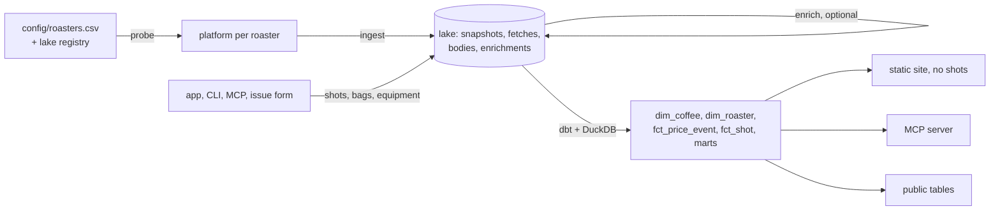

# Architecture

How the weekly run works, what the lake holds, the public tables and their contracts, and how the crawler
treats roasters' sites. Usage is in [USAGE.md](USAGE.md); operations are in
[`docs/ingestion/RUNBOOK.md`](ingestion/RUNBOOK.md) and [`docs/app/RUNNING.md`](app/RUNNING.md).

## The weekly run

`coffeedata weekly` runs these steps in order:

1. Discovery from Overture and OSM, once in the first week of each month (or with `--discover`).
2. Platform checks for roasters not checked in 28 days.
3. Ingest of every roaster with a usable platform, then one retry of that run's failures.
4. Claude enrichment, if a key is set: collect finished batches, then submit pending coffees.
5. The dbt build, and export of the marts.
6. The public tables (the weekly workflow then loads Snowflake in its own step, if configured).
7. The site.

With a remote lake, the run uploads after steps 2 through 5, and every 200 roasters during ingest, so a later
failure or a timeout keeps what was already fetched. Running the same week again picks up where it stopped.

**The lake is append-only, apart from `marts/`.** Each step adds files and never edits or deletes one, and
`Lake.write` refuses to overwrite. The derived `marts/` exports are replaced each run. Everything that describes the
current state is computed:

| Lake path | Written by | Holds |
|---|---|---|
| `run_manifests/run_date=…/batch=…` | ingest | written before the first request: the roasters an ingest sets out to fetch, each one's status then, and the mode (`full`, `sample`, `only`, `retry_failed`) |
| `snapshots/run_date=…/batch=…` | ingest | every product seen (coffee or not), with variants and prices, and a `payload_hash` of the store's raw product payload (a real change, or a repeated fetch; WooCommerce's separately fetched size prices aren't in it, since they depend on how the fetch went) |
| `fetches/…` | ingest | one row per roaster attempt, `ok` or `error`, with diagnostics: pages (200 responses other than robots.txt, so per-size and sitemap fetches count), requests, HTTP statuses, retries, 429s, duration and code version |
| `bodies/…` | ingest | product description text, stored once per new description |
| `enrichments/method=rules\|llm/…` | ingest, enrich | extracted attributes, keyed by product and description hash |
| `probes/…` | probe | store platform checks |
| `registry/source=…/…` | discover, issue form | roasters added (or opted out) beyond the seed list |
| `llm_batches/state=submitted\|collected/…` | enrich | Claude Message Batches bookkeeping |
| `shots/<id>__<time>-<random>.parquet` | app, CLI, MCP, issue form | one logged shot; corrections and retractions are new files |
| `equipment/<id>__<time>.parquet` | app | a grinder, machine or basket; changes are new files |
| `bags/<id>__<time>.parquet` | app | a bag of coffee in use, matched to the catalog when it can be |
| `run_overrides/override_id=….parquet` | `coffeedata override` | a person's call on one roaster-week: accept, reject or pin a batch |
| `builds/run_date=…/build=…` | build | one file per dbt build: node checksums and test results, catalog metrics, manifest and run results, and its environment (CI run id and URL, dbt and key package versions, duration) |
| `releases/run_date=…/build=…/<table>.parquet` | build | every build's release: the catalog marts, `mart_new_arrivals` and the four public tables, each row stamped with `release_build_id` and `release_run_date`. Only a passing release is served (`marts/` and `marts/release.parquet`) |
| `serving_log/serve_id=….parquet` | build, rollback | one row per serve or rollback: build, run, time, reason, actor and the release it replaced (`marts/release.parquet` holds only the current one) |
| `marts/*.parquet` | build | derived, and replaced each run |

The diagnostics, manifests, payload hashes, build environment and serving log are operational metadata: they
stay in the lake and the build records and never reach a served mart or a public table. Files written before a
column existed read it as null.

Bag photos have their own dataset (`COFFEEDATA_PHOTOS`), one `photos/<id>.parquet` per photo in Hugging Face's
`Image` layout, so a photo is never in the main lake. The app writes one when a bag's label is photographed.
Accounts and invites have another private dataset (`COFFEEDATA_USERS`) that dbt never reads.

Green importers' offer lists have a private dataset of their own too (`COFFEEDATA_IMPORTERS`,
[`src/coffeedata/importers_card.md`](../src/coffeedata/importers_card.md), its dataset card). **They are backend-only,
for internal use and a future roaster portal**: never in the public release, the `public_*` tables, the site or the
public dataset, and the main dbt project never reads them. Even in that portal, only the normalized values may be
shown, never the importer's wording. `coffeedata importer-snapshot` (`.github/workflows/importers.yml`, weekly on main) makes one
pass a week over each importer's public offer page and stores it raw: one immutable `raw/` file per importer and
week, each lot word for word (every cell of its row and its URL), as the roaster adapters keep a product's whole
text. No prices, page HTML or images. The stated fields and our normalized values are derived from raw by a private
dbt project of its own, `dbt_importers/` (`coffeedata importer-build`): staging unnests each lot's cells, and
intermediate models apply the rules (SQL over the vocabulary in `importer_rules.py`, `extract.py` and `origins.py`,
handed to dbt by a Python model; dbt unit tests in `dbt_importers/models/unit_tests.yml`) into `importer_offers`. It
builds into its own database file, only ever the checkout's `build/importers.duckdb`, which the main build, the release, the site, the
exports, the contracts and the MCP server never open (`tests/test_importers.py`). Each build re-derives the whole
history from raw, so a better rule applies to every week. After each weekly snapshot that passes, the workflow's `build` job runs
`coffeedata importer-build --publish` and keeps the latest build's `importer_offers` in the same private dataset, as
one file replaced at each build (`derived/importer_offers.parquet`), never read back by the build. dbt's output stays
on the runner and the run's log shows counts only, since the repository and its logs are public. A failed build
leaves the raw weeks and the last good copy as they are and opens a `pipeline:importer-build` triage issue
([`docs/TRIAGE.md`](TRIAGE.md)). InterAmerican's table has no origin, region, process or
grade column, so those are read from its product names ("Brazil Oberon 17/18 Natural"); it states no lot ID. The
rules abstain when unsure and haven't been evaluated yet (CLAUDE.md; status and running totals in
[`eval/importers/README.md`](../eval/importers/README.md)).

Royal Coffee, a Shopify store, is the third importer: its public `/products.json` listing is read one page of 250
after another, 15 s apart, and each product is kept word for word (its fields, tags, options, variants without
prices, and `body_html`'s text; no prices or images; a field that mentions a price is left out of that product).
Its values (lot number, warehouse, origin, region, process, varieties, altitude, harvest months, certifications) are
derived by the same private dbt project (`int_royal_labels`, `int_royal_rules`), like the others. Royal's terms restrict automated access and AI tools; the owner chose to include it. **No AI agent may
access Royal's site.** Its address is only in the importers workflow, passed to a scheduled run's first attempt
alone (never a dispatch or a re-run). `importers.royal_listing_url` refuses it anywhere else; that check reads
environment values, so it stops accidents, not a deliberate run. Every HTTP client but the importers job's, and the
roaster registry and discovery, refuse the host outright (`http.schedule_only_host`). Its tests use invented
products only (`tests/fixtures/importers/royal_synthetic_products.json`). **Owner step for a real drop at Royal:**
set the repository variable `ROYAL_ACCEPT_DROP_WEEK` to the value the failure names (the failed week's Monday,
`YYYY-MM-DD`); the next weekly run stores the thinned listing, and the value expires by itself a week later.

- **Re-running a week is safe.** Only roasters without a successful fetch that week are fetched again, and
  `stg_runs` keeps only the latest successful batch per roaster and week (checked in `tests/test_dbt.py`).
- **A site being down never looks like a delisting.** A failed fetch is recorded with no products, and price
  events compare consecutive *successful* fetches.
- **Neither does a broken catalog.** A fetch can succeed and still be wrong (a store that cut its listing short, an
  adapter bug). `stg_run_quality` holds a roaster-week out of history, like an outage, when its product count falls
  below half the median of its previous 4 weeks. The build warns (`suspect_runs_need_review`); review it, then
  `coffeedata override --roaster … --run-date … --action accept|reject --reason …`. `--action use_batch --batch …`
  pins which of a week's batches counts. Overrides are appended, so the history of every call is kept.
- **Only a release that passes every check is served, and every build is recorded.** dbt builds every model, then
  runs every test, so a failed check never stops a model from being built. The checks that gate serving:
  - `run_is_complete`: every roaster the run should have tried was tried (an error counts as tried). "Should
    have tried" is the run's full-run manifests; a run without one (from before manifests, or only `--sample`,
    `--only` or `--retry-failed` ingests) falls back to every roaster that is ingestable and was known when the
    run started. Other manifests only add to that set, so a partial ingest is never served as a full week;
  - `run_ok_rate`: at least 90% of those with a catalog were fetched with products (`no_catalog` stores, which
    "succeed" with nothing, aren't counted);
  - `adapter_ok_rate`: each adapter with at least 20 such roasters fetched at least half of them, so one
    platform's outage fails the run;
  - `build_metrics_in_band`: those ok shares (overall and per adapter, low side only) and the three volume
    metrics lie within median ± 1.5 × 1.4826 × MAD of the recent passing builds. A metric is banded only once it
    has 6 passing builds in its window; until then only the fixed thresholds apply, and they stay hard floors.
    `--accept-volume-change`, or a new accept override, starts the window again at that build. For now this
    check only warns: `band_k` is recalibrated on 8–12 weeks of real history before a band can block a release.
    TODO, at that point (about 8 weeks of history): replace the fixed suspect-week rule (below half the median of
    the last 4 counted weeks) with per-roaster MAD bands, both sides, warn-only, active once a roaster has 6 or
    more counted weeks and reset on accept or override, the same pattern as these bands;
  - `fill_and_freshness_in_band` (warn only, and it never blocks, even once the bands above can): the same bands,
    low side only, on the share of listed coffees with `origin_country`, `process`, `roast_level` and
    `price_per_100g` filled in (a drop is an extraction or enrichment break, which `accepted_values` lets through
    as nulls) and on the share of listed coffees last seen in this run;
  - `adapter_volume_in_band` (warn only): the same bands, low side only, at least 0.10 below the median, on three
    per-adapter metrics: the ok share of the roasters the run *tried* (unlike `adapter_ok_share`, it doesn't fall
    when a run just tries fewer roasters), and the same stores' products and priced products against their
    previous fetch (a platform whose fetches "succeed" with less, or a price wipe on one platform). Measured in
    `eval/dq`;
  - `public_roasters_unique_by_host` and `roaster_aliases_resolve`: one store is one public roaster. A roaster_id
    whose site resolves to another roaster's store (the same host, any case, without `www.`/`shop.`/`store.`) is
    an alias (`dim_roaster.status`, `canonical_roaster_id`): the crawl skips it and no public table lists it.
    A rebrand whose old domain doesn't redirect is set by hand (`alias_of` in `config/roasters.csv`). Measured in
    `eval/roaster_dedup`;
  - `near_duplicate_roasters`, `price_per_100g_outliers`, `public_tables_reconcile` and
    `release_changes_explained` (all warn only, measured in `eval/dq`): one catalog listed under two roaster_ids; a
    price per 100 g far from coffees of the same origin and process (robust z of its log, below −3 or above 6);
    totals that two public tables state separately (roaster counts, the listed total, a price event's roaster, a
    price event with no coffee row that isn't a reclassified product); and every row this build adds, removes or
    changes against the served release with a reason (`release_changes`, run after the gate as a report so it
    can never fail a build; the build prints the counts per reason as `release notes:` and records them in
    `builds` as `kind = 'release_change'`);
  - `catalog_volume_vs_last_build`: listed coffees, in-stock coffees and roasters moved at most 20% from the
    release being served;
  - `latest_run_is_fresh`: the newest run is at most 8 days older than the day of the build;
  - `verdicts_cover_catalog`: Claude's verdicts ran: the build has a verdict model, and at least 85% of listed
    coffees were decided by a verdict (`dim_coffee.classified_by = 'claude'`; about 95% is expected, as this
    week's new versions get theirs a week later). Off only for an explicit rules-only build (`--allow-rules-only`
    or `COFFEEDATA_ALLOW_RULES_ONLY=1`; RUNBOOK §5.5);
  - `public_coffee_is_fresh`: the public catalog's newest `last_seen` is the run the build checked (an empty catalog
    is left to the volume check);
  - `public_tables_are_one_release`: every row of every public table carries this build's `release_build_id`
    and `release_run_date`;
  - `public_tables_invariants`: rules the public tables hold by construction (in `public_market_weekly` p10 ≤
    median ≤ p90, `in_stock` ≤ `coffees` and `roasters` ≤ `coffees`; `first_seen` ≤ `last_seen`; a `price` event's
    prices differ; a `new` event has no previous price), so a row breaking one is a bug in the SQL;
  - `run_manifest_mode_values`: every run manifest's `mode` is `full`, `sample`, `only` or `retry_failed`
    (`run_completeness` takes the expected set from the full ones);
  - `coverage_claims_match_build`: the coverage numbers we publish (`marketplace/LISTING.md`'s coverage-claims
    comment, one `metric: text` line per number) are within 15% (`claim_tolerance`) of this build's
    `mart_build_profile`. It only warns, and `coffeedata build` prints the file and line to update, with the
    build's number rounded for the copy;
    `coverage_claims_name_metrics` fails the build if a claim names a metric the profile doesn't have;
  - the facts-only guardrail and the enforced dbt contracts on the public tables.

  Every build appends its record to `builds/` (each dbt node's checksum and test result, metrics, manifest and
  run results) and writes its release to `releases/`, passing or not. A passing release replaces `marts/`, the
  public export and the site. A failing one leaves the served release in place (the automatic rollback) and the
  weekly job ends red. `coffeedata rollback [--to BUILD]`, or the weekly workflow's `rollback_to` input, serves an
  earlier passing release. `coffeedata build-diff [--old ID --new ID]` compares two builds: changed models, test
  results, row counts, metrics and the coffees added, delisted or out of stock; by default the latest build
  against the last passing one before it. `coffeedata build-hashes [ID] [--against ID] [--verify]` prints a
  build's row count and content hash per release table and compares them with another build's, or with its
  release files as they are now; the same lake and code always give the same hashes
  (`tests/test_reproducible.py`), so a served release can be rebuilt from raw and checked
  (`docs/ingestion/RUNBOOK.md` §5.6). After reviewing a real change, run the weekly workflow with
  `accept_volume_change` (or `build --accept-volume-change`) to let it through the volume check and the bands and
  make it the new baseline.
- **Stable coffee IDs.** `coffee_id` is `<roaster domain>:<store product id>`, so a rename doesn't change it.
- **Old shots keep their gear.** Each grinder or basket added in Setup is a new record, so a shot keeps the
  equipment it was pulled with. A grind setting only compares within one grinder; `grind_position` (0 to 1 along
  the dial) is a rough comparison across grinders.
- **Past weeks can be re-processed.** Raw records keep non-coffee products and description text, so a better
  classifier or extractor can run over old weeks without fetching again.
- **Roaster status comes from history:** `active`, `no_coffee`, `no_catalog`, `pending`, `unreachable` or
  `opted_out`. A roaster with a known platform becomes `unreachable` after its last 3 weekly runs all failed, and a
  failed probe never erases a known platform. A roaster with no usable platform (none found yet, or an HTTP error
  such as `http_403`) is `unreachable` straight away.
- **Enrichment cost is capped.** Claude only sees coffees the rules couldn't fully read that have no `llm` result
  and aren't in a pending batch, up to `--limit` (default 2000). Up to 100 go through the API directly; more go
  through the Message Batches API and are collected next run. Anything skipped is picked up the following week.

Hugging Face datasets are versioned, handle Parquet well and can be queried by anyone with DuckDB. Git would be a
poor home for this data: its history only grows and every Actions checkout would download it. Lake storage lives
in `lake.py`, which is where another object store would plug in.

## Public tables

Four facts-only tables (`dbt/models/public/`): `public_coffee` (attributes, sizes, prices, stock and a link back to
the roaster), `public_price_event`, `public_market_weekly` and `public_roaster`. Descriptions and images belong to
the roasters, so they stay in the private lake. The tables leave out opted-out roasters and roasters known only from
OpenStreetMap. The `public_tables_are_facts_only` dbt test fails the build if a public table has a column on its
denylist: descriptions, images, store IDs, shot fields such as `rating`, `notes` and doses, and user, bag, grinder
and photo IDs. Snowflake and Databricks setup and the listing text are in [`marketplace/`](../marketplace/README.md).

A directory or Hugging Face export describes itself in `manifest.json`: the release (`release_build_id`,
`release_run_date`), the contract id and version, the data licence (id and URL) and each file's `sha256` and row
count. The licence text goes with it as `LICENSE` (the licence asks that its text travel with the data). An `s3://`
or `gs://` export writes only the Parquet files. A Hugging Face export of a release build also tags its commit `release-<run date>`
(the Monday run), so a past week stays readable by name
(`hf://datasets/<owner>/<name>@release-2026-11-02/data/public_coffee.parquet`). The tag follows the release served
for that run: a re-export of the same build leaves it, a newer build of the same run moves it to its own commit. An
export of a build without release ids (a plain `dbt build`) is not tagged.

The tables are a data product with a contract, in the Bitol open standards:
[`contracts/coffee-data.odps.yaml`](../contracts/coffee-data.odps.yaml) (ODPS v1.1.0) describes the product and its
output port, and [`contracts/public-catalog.odcs.yaml`](../contracts/public-catalog.odcs.yaml) (ODCS v3.2.0) defines
the four tables: columns and types, keys, required columns, allowed values, quality rules and SLAs (weekly, at most
8 days old, a 4-week rollback window). The contract is the definition and dbt enforces it: `tests/test_contracts.py`
validates both files against Bitol's JSON schemas and fails if dbt's enforced contracts, tests or thresholds
disagree with the contract. So a change to a public table starts in the contract. The contract also carries
context for AI agents (instructions, constraints, canonical questions and synonyms), so an assistant reading the
tables knows they are weekly, not live, and what not to claim.

The pipeline's internal contracts (raw, manifest and enrichment) are ODCS too, in
[`contracts/internal/`](../contracts/internal/), generated by `make contracts`: columns and types from `lake.SCHEMAS`,
descriptions and quality rules from `src/coffeedata/contract_docs.py`. They are not published;
`tests/test_raw_contracts.py` fails when they drift from the code. A change to names, types, required or enums needs
a new version (`python -m coffeedata.raw_contracts --write <name> <version>`); `make contracts` refuses it at the
old one, and writes a description-only change at the same version.

## Scraping etiquette

- Each store feed is read once a week, because catalogs change slowly and that keeps the load on small roaster
  sites low. Requests identify as `RegistryCoffeeBot/1.0 (+https://registry.coffee/bot; support@registry.coffee)`;
  [registry.coffee/bot](https://registry.coffee/bot) says what it crawls and how to opt out.
- `robots.txt` is followed, and a 401 or 403 on it counts as "disallow everything". Nothing is fetched from a site
  without its rules: if `robots.txt` answers 429, 430 or 503 (a pause), a challenge, or (with no stored copy, below)
  another 5xx or nothing at all, even after retries, the site is skipped and asked again 15 minutes later, so a site
  whose `robots.txt` never answers is never crawled. When `robots.txt` is unreachable (no response, or a 5xx that
  isn't a pause) and we stored the site's own answer within the last 30 days, that copy's rules are followed exactly
  (RFC 9309 2.4 allows a cached copy); older or none, nothing is fetched. Every fetch row records which copy was
  used (`fetches.robots`: live, or cached with its age).
  Requests to a host, robots.txt, catalog fetches and platform probes alike, are at least 1 second apart.
- robots.txt is read as RFC 9309 says, by our own matcher (`http.RobotsRules`): the groups for `RegistryCoffeeBot`
  apply, or the `*` group when none names it (product-token matching: case-insensitive, the exact token), and any
  groups for the old token `coffee-data` apply as well; a URL is fetched only if all of them allow it. The longest
  matching rule decides (allow on a tie), and `*` and `$` wildcards are honoured. A `Crawl-delay` from those groups
  replaces the spacing when it is longer, up to 60 seconds: a longer one, or one with no readable number, is capped at
  60 seconds (`10s` reads as 10), and the cap is recorded in `fetches.crawl_delays`. A host's Crawl-delay is never waited out past the crawl's deadline.
- Only what a shopper can see is stored, and every coffee links back to its roaster.
- Roasters who want to be left out can open an issue. The owner records the opt-out with the "Exclude this
  roaster" box on the "Add a roaster" form, and the site is never fetched again.
- By design, the project doesn't use directories whose terms forbid scraping, sources whose terms forbid storing
  their data, or sites that block bots.
